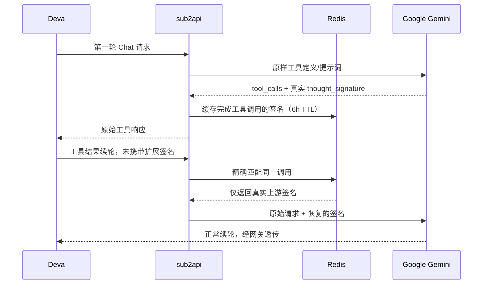

# Deva → Gemini 服务端签名兼容修复

## 根因与边界

2026-10-29 的真实请求日志显示：Deva 使用 OpenAI Chat Completions 调用 Gemini，后续请求的历史工具调用只包含 id/type/function，缺少 Google 的 `extra_content.google.thought_signature`。Google 于是拒绝工具续轮；此前网关仅原样返回签名和明确的 400，没有保存/恢复该元数据的能力。

这不是 API Key 无效。前一轮 `0.1.338` 只修复了 stop/tool_calls 结束状态与预付费余额耗尽分类，**没有修复服务端对丢失签名的客户端兼容**。

本轮仅修网关，不修改 Deva 或其他本机客户端，不替换 app.asar，不更改模型、思考等级、工具参数、策略或分组。

## 实现

- 作用域包含用户 API Key ID、分组、账号 ID、凭证、映射后模型和会话。客户端没有显式会话头时，复用已有的首用户消息/system/tools 稳定种子。
- 调用键包含工具 ID、函数名和参数的规范 JSON 摘要；参数解码保留大整数精度，原始参数字节不改写。
- 只从上游已完成的工具响应学习，不从用户请求学习签名，已有客户端签名不覆盖。
- 同时覆盖 JSON 非流式和 SSE 分片；跨 chunk 拼接完整参数和签名，在工具终止事件前存入 Redis，避免客户端立即续轮的竞争。
- Redis 存 opaque 签名及哈希键，不存原始提示词或工具参数；TTL 6 小时。每次最多跟踪 128 个调用、参数上限 1MiB、单签名上限 32KiB；未完成、拒绝、截断或超限调用不缓存。
- 缓存不可用或未命中时保留原请求，不造签名、不填 dummy、不删除工具历史、不换号掩盖参数错误，不惩罚账号。
- 日志只记录缓存/恢复计数和账号 ID，不记录签名与参数。

## 验证

- 服务端测试覆盖：Deva 漏扩展字段自动修复、未知扩展与原始参数保留、大整数/对象键序、流式分片、无会话头、跨用户/组/账号/凭证/模型/会话隔离、缓存故障、截断/未完成/超限、不学习或覆盖客户端签名。
- 通过独立临时 Redis 实测跨 repository 实例读取、作用域隔离和 TTL 到期；测试实例已退出。
- `go test -tags unit ./internal/service ./internal/handler ./internal/handler/admin ./internal/repository -count=1`、embed 包测试通过。
- 定向签名恢复的 `go test -race` 通过。
- 发布及线上“客户端故意删除签名仍能续轮”验收在完成后补充。

## 不能凭空恢复的情况

发布前已丢失且网关从未缓存过的真实签名，无法从 id/参数反算。旧对话若正在重试同一个缺签名工具调用，需要新建一次会话或重新发起新的用户回合，让新生成的工具调用先经过缓存。Redis 到期、账号/凭证/模型或会话种子改变时也可能无法匹配；此时返回真实 400，不伪装成功。

本轮没有调整慢账号冷却策略，也没有修改客户端取消在日志中显示为 502 的另一项问题。
